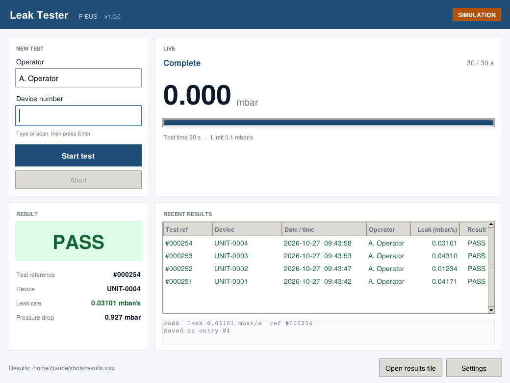

# F-BUS Leak Tester

A small desktop app for running pressure-decay leak tests on a **Furness Controls F-BUS** leak tester (developed against the FCO780) over USB/RS-232. Each result is logged to a formatted Excel workbook with a live summary sheet and charts.



## Features

- **Tkinter UI**: enter the operator, type or scan the device number, then press **Enter**. It shows live stage, pressure and progress, then a large PASS/FAIL result.
- **F-BUS driver**: framing, BCC checksums, status polling, start/reset commands and result parsing.
- **Excel log**: one styled row per test, plus a `Summary` sheet with pass/fail counts, pass %, min/max/avg leak rate and charts.
- **Two-level pass/fail**: a test passes only if the instrument passes it **and** the leak rate is within the app's own limit.
- **Simulation mode**: try the whole workflow without any hardware.
- **Barcode-scanner friendly**: after each test the device field clears and gets focus again.
- **Safe saving**: if the workbook is open in Excel, the app asks you to close it and retry instead of losing the result.

## Quick start

```bash
pip install -r requirements.txt

python app.py --simulate      # try it without hardware
python app.py                 # use the instrument configured in config.json
```

On first run, open **Settings** to set the COM port, F-BUS ID, test time and pass limit. Your settings go in `config.json`, which is git-ignored. `config.example.json` lists every key.

> Tkinter comes with the standard Windows/macOS Python installers. On Debian/Ubuntu, run `sudo apt install python3-tk`.

## Configuration

| Key | Meaning |
| --- | --- |
| `serial_port` | USB virtual COM port, e.g. `COM3` or `/dev/ttyUSB0` |
| `baud_rate` | Must match the instrument (default 9600) |
| `fbus_id` | Instrument F-BUS address, 2 characters (default `01`) |
| `test_duration_s` | Test time. **Must match the test programme on the instrument** |
| `pass_threshold_mbar_s` | The app's own leak-rate limit |
| `target_pressure_mbar` | Test pressure (used by the simulator and display) |
| `poll_interval_s`, `ready_timeout_s`, `max_wait_s` | Polling behaviour |
| `excel_file` | Where results are written |
| `simulate` | Start in simulation mode |

The default limits are **placeholders**. Set them to your own product specification.

## How a test runs

1. Poll `M000` until the instrument reports ready (`f=0`).
2. Send `G000` (start).
3. Poll `M000` for stage (`k`) and pressure (`g`) until a new result is flagged (`d=1`).
4. Read `L002`. Tag `a` is the test counter, shown as the test reference `#000123` to match the front panel. Tag `e` is the status (`0` = pass), `f` is the pressure and `h` is the leak reading.
5. If there's no `h` reading, leak rate = (start − end pressure) / test time, where the start pressure is the first reading in the test stage.
6. Send `H000` (reset).

Tag meanings can vary between firmware versions, so check them against your instrument's F-BUS manual. The app assumes the instrument reports the leak reading (`h`) in mbar/s. If your instrument uses other units, change the threshold to match.

## Project layout

```
app.py                  entry point
leaktest/
  fbus.py               F-BUS framing + instrument driver
  simulator.py          simulated instrument (same interface)
  runner.py             hardware-agnostic test sequence
  excel_log.py          Excel results + summary sheet
  gui.py                Tkinter UI
  config.py             config.json handling
examples/               sample workbook produced by the simulator
tests/                  pytest suite (runs without hardware)
```

## Building a Windows executable

```bash
pip install pyinstaller
pyinstaller --onefile --windowed --name LeakTester app.py
```

Put `config.json` next to the `.exe`.

## Tests

```bash
pip install pytest
pytest
```

The driver is tested against a fake serial port, so you don't need hardware.

## Disclaimer

This is an independent project, not affiliated with or endorsed by Furness Controls. *Furness Controls*, *F-BUS* and *FCO780* are their trademarks. Validate the app against your own quality procedures before you use it in production.

## License

MIT. See [LICENSE](LICENSE).
